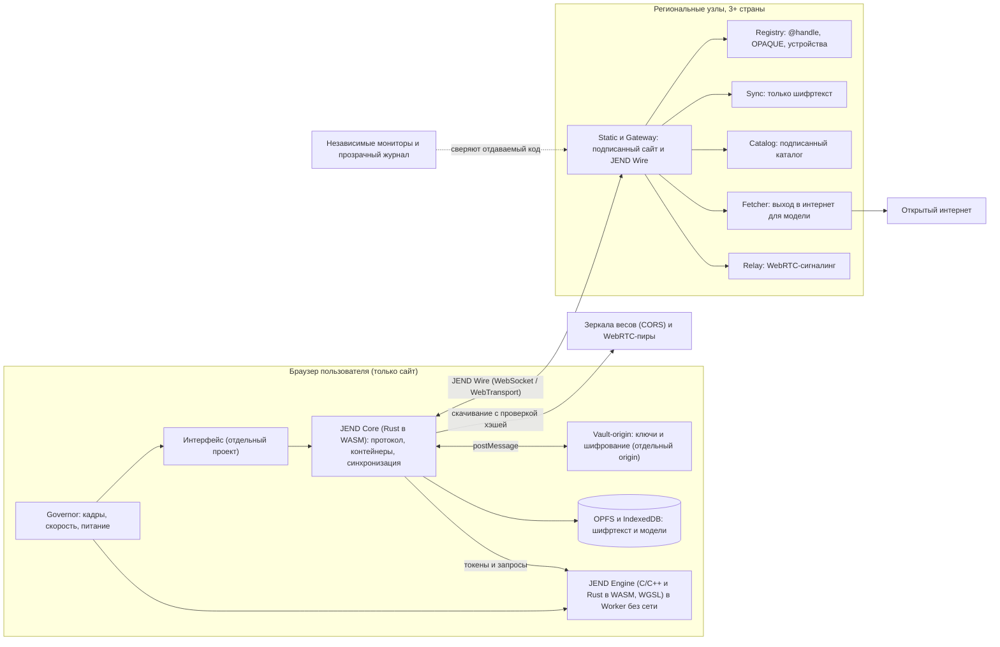
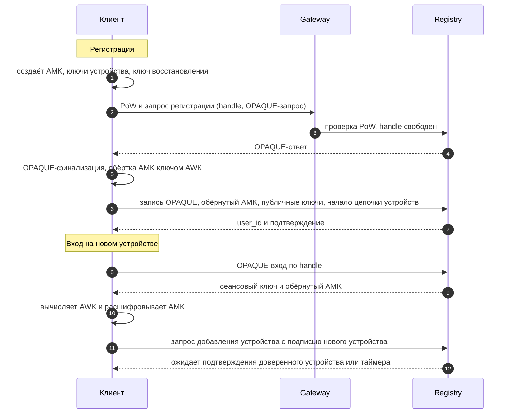
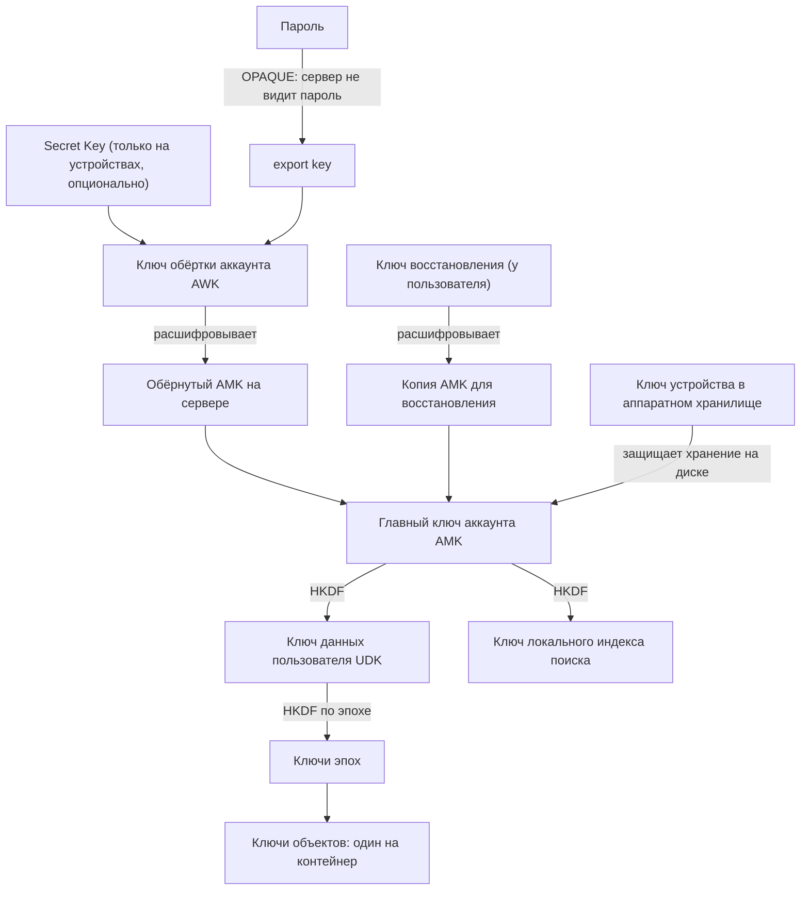
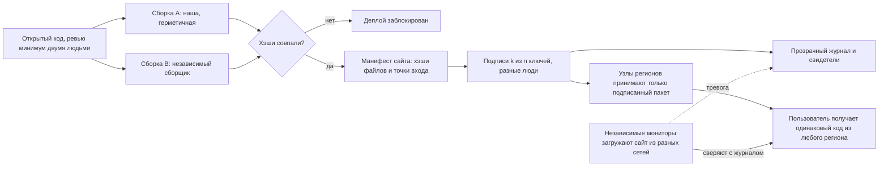
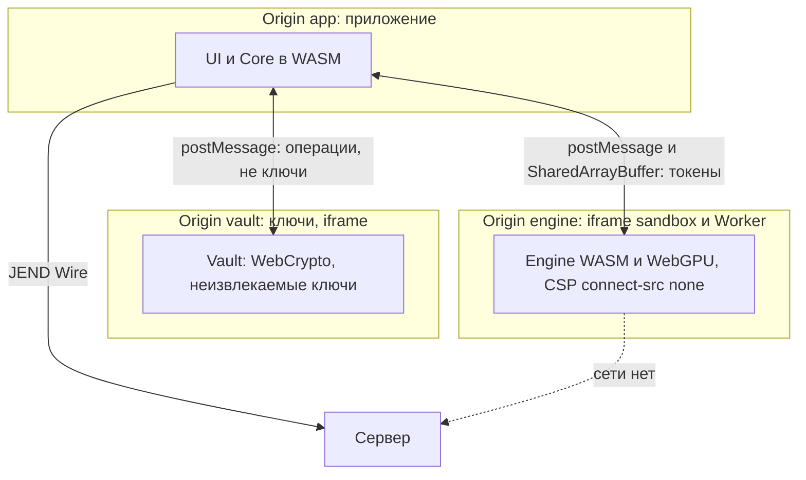
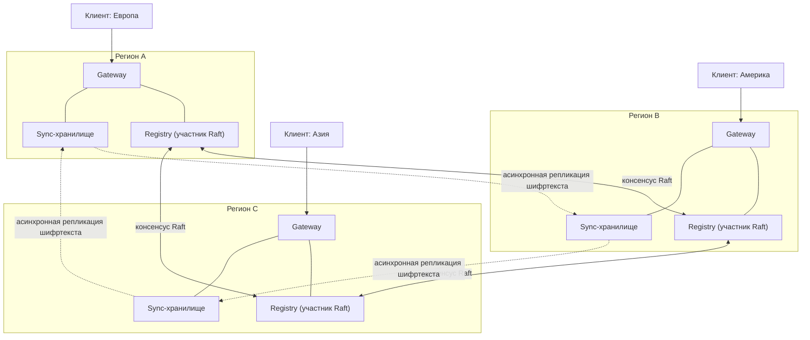
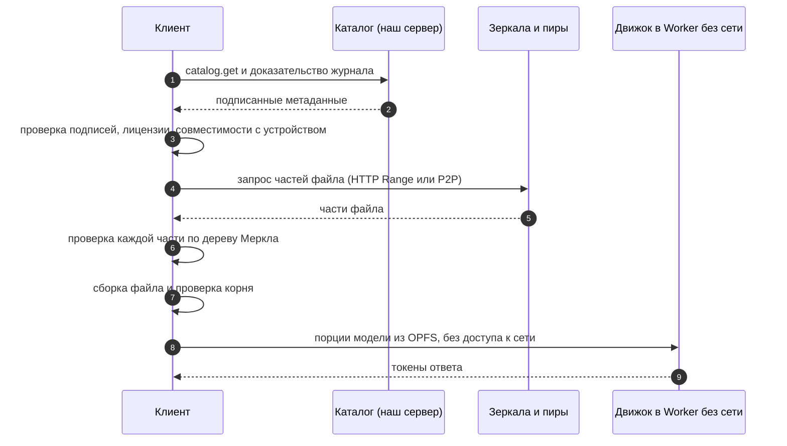
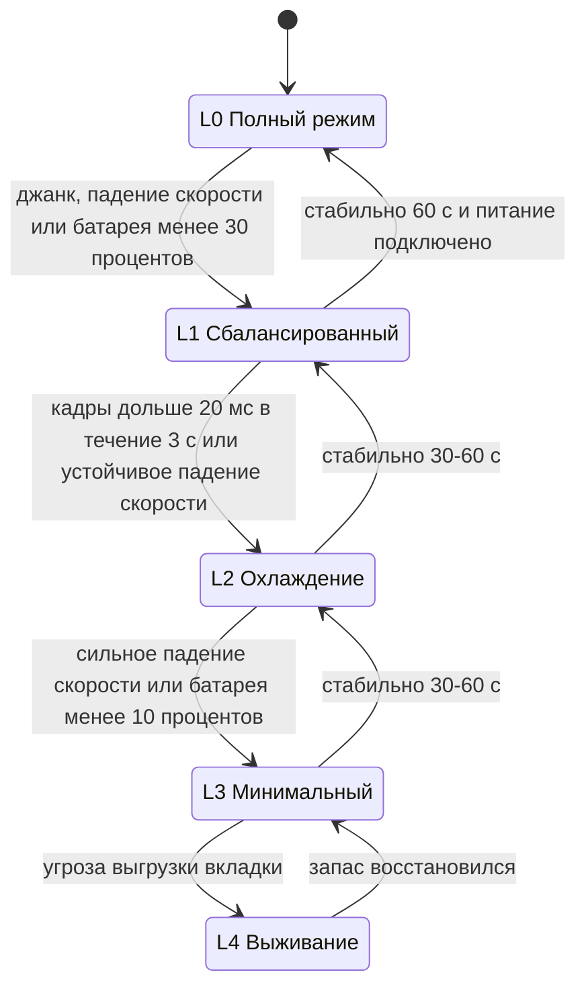
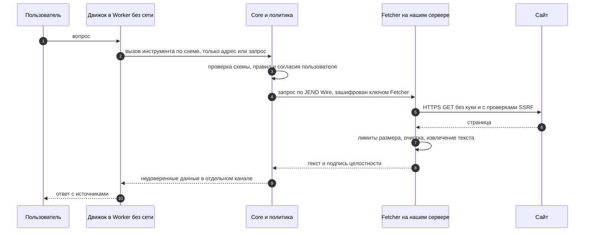
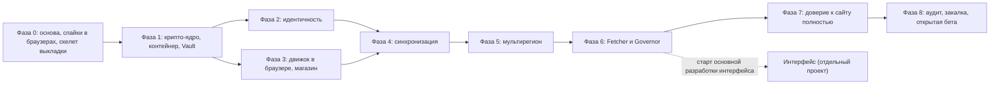

# JEND: архитектура локальных ИИ-моделей с E2EE для сайта (редакция «только сайт»)

> **JEND** это кодовое имя **технической архитектуры**, а не название сервиса.
> Редакция **v0.2: только сайт**, без нативных приложений и расширений браузера. Заменяет v0.1, где часть решений была рассчитана на приложения.
> Документ одновременно план разработки и промпт для будущих сессий (человек или ИИ-ассистент).
> Статус: черновик архитектуры, 2026-10-17. Интерфейс (UI) разрабатывается отдельно, после архитектуры.

## Оглавление

- [Что изменилось по сравнению с v0.1](#что-изменилось-по-сравнению-с-v01)
- [Кратко](#кратко)
- [Как использовать этот документ](#как-использовать-этот-документ)
- [1. Что строим](#1-что-строим)
- [2. Честные границы](#2-честные-границы)
- [3. Архитектура целиком](#3-архитектура-целиком)
- [Шаг 1. Регистрация и вход](#шаг-1-регистрация-и-вход)
- [Шаг 2. Доверие к сайту: сообщения не читаются, подмена кода заметна](#шаг-2-доверие-к-сайту-сообщения-не-читаются-подмена-кода-заметна)
- [Шаг 3. Протокол JEND, контейнер и синхронизация](#шаг-3-протокол-jend-контейнер-и-синхронизация)
- [Шаг 4. Собственная архитектура: движок в браузере](#шаг-4-собственная-архитектура-движок-в-браузере)
- [Шаг 5. Дешёвые серверы и бюджет](#шаг-5-дешёвые-серверы-и-бюджет)
- [Шаг 6. Несколько регионов и отказоустойчивость](#шаг-6-несколько-регионов-и-отказоустойчивость)
- [Шаг 7. Магазин моделей без хранения весов на серверах](#шаг-7-магазин-моделей-без-хранения-весов-на-серверах)
- [Шаг 8. Governor: плавность и нагрузка в браузере](#шаг-8-governor-плавность-и-нагрузка-в-браузере)
- [Дополнительные шаги](#дополнительные-шаги)
  - [Доп. шаг A. Выход модели в интернет (Fetcher)](#доп-шаг-a-выход-модели-в-интернет-fetcher)
  - [Доп. шаг B. Совместимость браузеров и хранилище](#доп-шаг-b-совместимость-браузеров-и-хранилище)
  - [Доп. шаг C. Тестирование и проверка (общий план)](#доп-шаг-c-тестирование-и-проверка-общий-план)
  - [Доп. шаг D. Наблюдаемость без нарушения приватности](#доп-шаг-d-наблюдаемость-без-нарушения-приватности)
  - [Доп. шаг E. Злоупотребления, модерация, юридическое](#доп-шаг-e-злоупотребления-модерация-юридическое)
  - [Доп. шаг F. Проектная гигиена](#доп-шаг-f-проектная-гигиена)
- [Дорожная карта](#дорожная-карта)
- [Риски](#риски)
- [Открытые вопросы к владельцу проекта](#открытые-вопросы-к-владельцу-проекта)
- [Приложение](#приложение)

## Что изменилось по сравнению с v0.1

Ответ на вопрос «план был про сайт?»: **частично**. В v0.1 я рекомендовал нативные приложения первыми и считал сайт «лёгким клиентом». Для проекта «только сайт» это неверно, поэтому ниже всё перестроено.

| Тема | v0.1 (приложения и сайт) | v0.2 (только сайт) |
|---|---|---|
| Доверие к коду | Подписанные релизы приложений, клиент проверяет сам | Код приходит с сервера при каждом открытии. Защита: подписанные деплои, проверка на краю, независимые мониторы, изоляция origin. **Доказать пользователю честность сервера невозможно** |
| Движок | C/C++ нативно, песочница ОС | C/C++ и Rust в WebAssembly, ядра на WGSL (WebGPU), изоляция средствами браузера |
| Ассемблер | точечно в горячих циклах | в браузере недоступен. Роль ассемблера выполняют WASM SIMD и шейдеры WGSL |
| Ключи | аппаратные хранилища ОС | неизвлекаемые ключи WebCrypto и passkeys (WebAuthn PRF), без гарантии привязки к устройству |
| Интернет для модели | брокер на устройстве | браузер не может читать чужие сайты (CORS), нужен **серверный Fetcher**, который видит адреса |
| Размер моделей | до десятков млрд | реально 1-4 млрд параметров на ПК с WebGPU, меньше на телефоне |
| Данные в браузере | постоянные | Safari и другие браузеры могут стирать. Ключи и модели нужно уметь восстановить |
| Governor | датчики ОС | только веб-сигналы, нагрев определяем косвенно по падению скорости |
| Режим «Мой ПК» | прямой канал | только опционально через WebRTC и открытую вкладку на ПК |

## Кратко

Пользователь открывает сайт с любого устройства, входит по `@имя` и паролю, выбирает в магазине открытую модель и пользуется бесплатно. Модель **считает в браузере пользователя** (WebAssembly и WebGPU). Чаты шифруются в браузере и синхронизируются между устройствами через серверы, которые видят только шифртекст. Для выхода модели в интернет есть серверный Fetcher. Серверы дешёвые, в нескольких странах, не хранят модели и не считают ответы.

Восемь опорных идей (номера совпадают с вашими пунктами):

1. **Вход.** `@handle` и пароль через OPAQUE: сервер не видит пароль. Почты и телефона нет, поэтому восстановление только по ключу восстановления.
2. **Доверие для сайта.** Ключи и шифрование живут в отдельном origin. Сайт выкатывается только с подписями нескольких независимых людей, всё публично фиксируется, независимые мониторы сверяют то, что реально получают пользователи. Это делает подмену заметной и дорогой, но не невозможной.
3. **Протокол и контейнер JEND.** Открытая спецификация из проверенных стандартов. Файл без ключей аккаунта бесполезен, есть политики времени и экспорт резервной копии.
4. **Своё, а не чужое.** Свой узкий протокол **JEND Wire**, никаких сторонних облачных API. Проверенные открытые библиотеки вместо самописной криптографии.
5. **Серверы помогают без открытого текста:** раздача подписанного сайта, каталог, синхронизация шифртекста, сигналинг, Fetcher. Вычислений моделей на серверах нет.
6. **Регионы.** Малый консенсусный реестр (Raft) в 3+ странах и реплицируемые журналы шифртекста. Сайт local-first: после первой загрузки работает из кэша.
7. **Магазин.** Подписанный каталог с хэшами. Веса идут с внешних зеркал (с CORS) и из WebRTC-P2P с проверкой по частям.
8. **Governor.** Следит за плавностью кадров, скоростью генерации и питанием, меняет анимации и нагрузку модели.

## Как использовать этот документ

Каждый шаг заканчивается блоком «Промпт для ИИ-исполнителя».

<details>
<summary>Общие правила для любой сессии разработки (вставлять в начало)</summary>

```text
Ты инженер-архитектор и разработчик. Реализуешь архитектуру JEND (редакция "только сайт") по документу
JEND-ARCHITECTURE-PLAN-WEB.md.

1. Работай по шагам 1-8 и доп. шагам A-F в порядке дорожной карты. Не переходи к следующему гейту,
   пока не выполнены критерии приёмки текущего.
2. Ничего не объявляй готовым или безопасным без доказательства: тест, лог, коммит. Различай уровни:
   S  = синтетика или макет,
   R1 = реальная проверка малого масштаба,
   R2 = реальная проверка на целевых браузерах и устройствах.
   Результат S никогда не повышай до R1 или R2.
3. Это ТОЛЬКО сайт. Любое решение проверяй на ограничения браузера: память вкладки, квоты и стирание
   хранилища, CORS, отсутствие аппаратных ключей, фоновые вкладки, различия Safari, Chrome, Firefox.
4. Не изобретай криптографические примитивы. Только проверенные библиотеки и стандарты.
5. Любое решение, меняющее модель угроз, протокол или формат, оформляй как ADR и обновляй документ.
6. Не добавляй сторонние облачные API в критический путь. Каждую зависимость обосновывай.
7. Если требование недостижимо буквально, скажи прямо и предложи ближайший честный вариант.
8. Каждое изменение: код + тесты + обновление документации + запись в журнале решений.
9. Формат ответа: (а) что сделано, (б) как проверено (команды и ожидаемый вывод),
   (в) что НЕ сделано, (г) следующий шаг.
```

</details>

## 1. Что строим

**Сервис (для контекста).** Сайт, где пользователь регистрируется по `@handle`, выбирает открытую модель в магазине и общается с ней. Модель работает локально в браузере. У модели есть доступ в интернет через Fetcher. Чаты синхронизируются между браузерами и устройствами аккаунта.

**Входит в архитектуру JEND:** идентичность и вход, E2EE и доверие к сайту, формат контейнера и протокол, собственный узкий протокол клиент-сервер, серверный слой (раздача сайта, каталог, реестр, синхронизация, сигналинг, Fetcher), многорегиональность, магазин моделей без хранения весов, движок в браузере, Governor.

**Не входит:** интерфейс (отдельный проект поверх готовой архитектуры), нативные приложения и расширения браузера, обучение моделей, серверный инференс, платежи, публичные социальные функции. Установка сайта на главный экран (PWA) остаётся тем же сайтом и рекомендуется.

## 2. Честные границы

Часть требований нельзя выполнить буквально. Ниже, что гарантируем и что обещать нельзя.

| # | Требование | Что реально гарантируем | Чего нельзя обещать |
|---|---|---|---|
| 1 | Вход по `@` и паролю без почты и телефона | Нет персональных данных. Пароль не покидает браузер. Ключ восстановления | Сброс пароля без ключа. Потеряли пароль и ключ: данные потеряны |
| 2 | Даже разработчик не прочитает сообщения и не внесёт вредоносный код | Серверы видят только шифртекст (это выполнимо). Выкат сайта требует подписей нескольких независимых людей, всё публично фиксируется, мониторы сверяют отдаваемый код, ключи изолированы в отдельном origin | **Доказать, что сервер отдаёт честный код, нельзя.** Браузер получает код при каждом открытии, недобросовестный или взломанный оператор способен отдать другой код, в том числе выборочно. Цель: подмена должна быть заметной и дорогой, а не невозможной |
| 3 | Протокол, который открывается только нашей архитектурой | Открытая спецификация, секрет только в ключах. Файл без ключей аккаунта не расшифровать | Секретность самого формата как защита |
| 4 | Всё своё, без API | Свой узкий протокол JEND Wire. Нет сторонних облачных и ИИ-API. Браузерные API (WebCrypto, WebGPU, OPFS) это платформа | Писать с нуля криптопримитивы и вычислительные ядра |
| 5 | Серверы помогают запускать модели | Раздача сайта, каталог, синхронизация, сигналинг, Fetcher | Считать промпты на сервере: раскрывает текст и не помещается в бюджет |
| 6 | 100 пользователей = 100 ₽ | Копеечные переменные расходы. Фикс. расходы 3 регионов около 2 тыс. ₽ в месяц | 1 ₽ на пользователя при менее чем ~2 тыс. активных. Аудиты и людей эта цифра не покрывает |
| 7 | Везде быстро, ничего не падает | Local-first, 3+ региона, failover | Мгновенная глобальная запись: между континентами 100-250 мс на операции консенсуса |
| 8 | Модель выходит в интернет, оставаясь локальной | Модель в браузере, наружу уходит только адрес или поисковый запрос | Приватность «как у полностью локального»: **Fetcher на нашем сервере видит адреса**, потому что браузер не может читать чужие сайты (CORS) |
| 9 | Модели не на наших серверах | Подписанный каталог, зеркала с CORS, WebRTC-P2P | Доступность, если зеркало исчезло и нет пиров |
| 10 | Адаптивный интерфейс | Governor на веб-сигналах | Датчики нагрева: в браузере их нет, нагрев определяем косвенно |
| 11 | Сильные модели | Модели 1-4 млрд параметров на ПК с WebGPU | 7 млрд и больше в браузере для массового пользователя, мощные модели на слабых телефонах |
| 12 | Данные хранятся на устройстве | Всё восстановимо: ключи входом, чаты синхронизацией, модели повторной загрузкой | Гарантия хранения: браузер может стереть данные сайта |

## 3. Архитектура целиком



### 3.1 Компоненты и языки

| Компонент | Где | Язык | Задача |
|---|---|---|---|
| JEND Core | браузер | Rust (WebAssembly) | ключи (через Vault), протокол, контейнеры, синхронизация, политики |
| Vault-origin | браузер | Rust (WASM) + минимум TypeScript | хранение ключей и шифрование в отдельном origin |
| JEND Engine | браузер | C/C++ и Rust (WASM, SIMD), шейдеры WGSL | запуск модели, KV-кэш, токенизация, ядра |
| Model Manager | браузер | TypeScript + Rust (WASM) | каталог, загрузка, WebRTC-P2P, проверка хэшей, OPFS |
| Governor | браузер | TypeScript (Rust в WASM для политики) | адаптация нагрузки и интерфейса |
| UI | браузер | TypeScript (отдельный проект) | интерфейс |
| Static и Gateway | сервер | Rust | подписанный сайт, JEND Wire, лимиты, PoW |
| Registry | сервер | Rust + Raft | `@handle`, OPAQUE-записи, цепочки устройств |
| Sync | сервер | Rust | журналы шифртекста |
| Catalog | сервер | статика | подписанные метаданные моделей |
| Fetcher | сервер | Rust | выход модели в интернет (шаг A) |
| Relay | сервер | Rust | сигналинг WebRTC, только шифртекст |
| TransLog и мониторы | серверы и свидетели | Rust | прозрачный журнал, проверка отдаваемого кода |

### 3.2 Структура репозитория

```text
jend/
├── docs/
│   ├── spec/          # JEND-WIRE, JEND-CONTAINER, JEND-CATALOG, JEND-ENGINE-ABI
│   ├── adr/           # записи архитектурных решений
│   └── threat-model/  # модель угроз, обновляется каждую фазу
├── core/              # Rust: ключи, контейнеры, синхронизация, политики (цели: wasm и нативный для тестов)
├── vault/             # отдельный минимальный origin для ключей
├── engine/            # C/C++ и Rust: рантайм, ABI, WASM SIMD; shaders/ с WGSL-ядрами
├── web/               # тонкая оболочка: загрузчик, Service Worker, заголовки; UI отдельно
├── server/            # Rust: gateway, registry, sync, relay, fetcher, translog
├── catalog/           # инструменты сборки и подписи каталога
├── monitors/          # независимые мониторы отдаваемого кода
├── tests/             # interop, fuzz, chaos, perf, browser matrix
├── infra/             # IaC, образы, воспроизводимые сборки
└── tools/             # подпись деплоя, верификаторы
```

### 3.3 Политика языков

- **Rust** для всего, что парсит чужие данные или несёт доверие: протокол, контейнеры, сеть, серверы, Fetcher, политики. Компилируется и в WebAssembly для браузера, и нативно для серверов и тестов. В серверных крейтах `#![forbid(unsafe_code)]`.
- **C/C++** для вычислительного ядра движка: компиляция в WebAssembly (Emscripten) с SIMD, многопоточность через cross-origin isolation. Только за стабильным ABI, с санитайзерами и фаззингом нативных сборок.
- **WGSL** для вычислительных шейдеров WebGPU (квантованное умножение матриц и др.). Каждое ядро с эталонной реализацией на C и дифференциальным тестом.
- **TypeScript** только для тонкого связующего слоя и интерфейса. Вся логика безопасности в Rust/WASM.
- **Ассемблер:** на сайте не исполняется. Вместо него WASM SIMD и WGSL. Нативный ассемблер имел бы смысл только для серверных вычислительных задач, но там криптографию берём из проверенных библиотек, а вычислений у серверов нет.

### 3.4 Собственный протокол вместо универсального API

Вы просили «всё своё и под строго свои задачи». Это правильно по безопасности: меньше универсальности значит меньше поверхности атаки. Реализация называется **JEND Wire**:

- бинарный протокол поверх TLS 1.3, который браузер обслуживает сам. В браузере транспорт это WebSocket (бинарные кадры), `fetch` с потоками, а где доступно, WebTransport. Без JSON, без HTML, без cookie, без автодокументации;
- закрытый список операций (порядка 20): `register`, `login`, `device.add`, `sync.push`, `sync.pull`, `catalog.get`, `fetch.request` и так далее. У каждой строгая схема, жёсткие лимиты размера и capability-токен;
- Gateway отбрасывает всё вне схемы до сервисов (запрет по умолчанию);
- один парсер на протокол, на Rust, непрерывно фаззится;
- версия протокола в рукопожатии, откат запрещён без явного решения;
- **закрепить сертификат (pinning) в браузере нельзя**, поэтому мониторим Certificate Transparency, ставим CAA, HSTS preload и DNSSEC.

Это не «самописная криптография»: TLS, AEAD, подписи, OPAQUE и HPKE берутся из проверенных реализаций.

### 3.5 Политика зависимостей

- **Разрешены:** открытые библиотеки с закреплённой версией, вендорингом и обзором (libsodium, RustCrypto, OpenMLS, SQLite для WASM, ядра llama.cpp/ggml или аналоги для WebGPU).
- **Платформа:** браузерные API (WebCrypto, WebGPU, WebAssembly, OPFS, WebRTC) это среда выполнения, а не сторонние сервисы.
- **Инфраструктура** (VPS, DNS, регистратор) допустима, если заменима.
- **Запрещены в критическом пути:** облачные ИИ-API, внешняя аутентификация (OAuth, SaaS), email и SMS, push-сервисы, внешняя аналитика и краш-репорты, внешние CAPTCHA, сторонние скрипты и CDN с логикой на странице.
- **Критерии добавления зависимости:** лицензия, поддержка, аудит, объём `unsafe`, возможность воспроизвести сборку, размер в WASM.

### 3.6 Экономика атаки: почему взламывать невыгодно

| Принцип | Эффект |
|---|---|
| Серверы хранят только шифртекст | Взлом сервера не даёт сообщений |
| Ключи у каждого пользователя свои | Нет «одного ключа от всего» |
| OPAQUE + Argon2id (+ необязательный Secret Key) | Украденная база не даёт дешёвого офлайн-перебора |
| Ключи в отдельном origin, строгая CSP, Trusted Types | Уязвимость в интерфейсе (XSS) не раскрывает ключи |
| Движок в Worker без сети | Вредоносная модель не может вынести данные |
| Подписанные деплои и независимые мониторы | Подмена сайта заметна, цена атаки выше |
| Малое число операций протокола, строгие схемы | Мало мест для багов, быстрее аудит |
| Лимиты, PoW, квоты | Массовая автоматизация атак дорожает |
| Программа вознаграждений и публичные аудиты | Находки выгоднее сообщить нам |

---

## Шаг 1. Регистрация и вход

**Цель.** Вход по `@handle` и паролю с любого устройства. Сервер не узнаёт пароль. Почты и телефона нет. Новые устройства добавляются безопасно. Есть восстановление. Массовые регистрации и перебор паролей экономически невыгодны.

### Решение

1. **Handle.** От 3 до 32 символов `a-z 0-9 _ . -`, без разделителя в начале и в конце. Регистр не различается. Перед проверкой уникальности: нормализация Unicode (NFKC) и защита от визуально похожих символов (UTS #39). Список зарезервированных имён. Смена не чаще раза в N дней, старый handle остаётся занят 30 дней.
2. **Вход через OPAQUE** (RFC 9807, документ IRTF/CFRG информационного статуса, не стандарт IETF, но рецензирован сообществом криптографов). Пароль не передаётся и не хранится ни в каком виде. Растяжение пароля (Argon2id) выполняется в браузере (WebAssembly), поэтому сервер не нагружается, а параметры памяти подбираются под самые слабые целевые телефоны (порядка десятков и сотен МиБ), иначе вкладка будет убита. Кража базы сервера не даёт дешёвого офлайн-перебора: нужен ещё серверный ключ OPRF. Поэтому ключ OPRF хранится **отдельно от базы** (отдельный секрет, позже он делится между регионами, шаг 6). Если украдены и база, и ключ, защита сводится к стоимости Argon2id, а в усиленном режиме остаётся Secret Key.
3. **Иерархия ключей** (схема ниже). Главный ключ аккаунта `AMK` создаётся случайно на устройстве. На сервере он лежит только в обёрнутом виде: под ключом от пароля и отдельно под ключом восстановления.
4. **Устройства и цепочка устройств.** «Устройство» в браузере это установка в конкретном профиле. У неё своя пара ключей, приватные ключи неизвлекаемые (WebCrypto) и лежат в Vault-origin. Где поддерживается, доступен passkey с расширением PRF (Secure Enclave, TPM, менеджер паролей): он даёт секрет, привязанный к аутентификатору. **Гарантии привязки к конкретному устройству в браузере нет:** копия профиля может унести ключ, поэтому для высокой защиты рекомендуем passkey или Secret Key. Добавления и удаления устройств записываются в подписанную цепочку. Сервер хранит её, но не может подделать.
5. **Добавление устройства.** Рекомендуемый путь: подтверждение с уже доверенного устройства (QR или код). Режим «только пароль» допустим, но с задержкой (например 24 часа), с видимым уведомлением на других устройствах и с возможностью отмены. Усиленный режим: к паролю добавляется **Secret Key**, который хранится только на устройствах и вводится на новом вручную. Тогда даже утечка серверных секретов не даёт перебора.
6. **Сеансы.** Короткоживущие токены, привязанные к ключу устройства (каждый запрос подписывается неизвлекаемым ключом WebCrypto), поэтому украденный токен бесполезен. Cookie не используются, поэтому нет CSRF. Токены живут только в памяти Vault-origin.
7. **Восстановление.** Ключ восстановления (24 слова или QR) создаётся при регистрации и показывается один раз. Пользователь подтверждает, что сохранил его (выборочный ввод слов). Без пароля и без ключа данные не восстановить, и это нужно честно сказать в интерфейсе.
8. **Анти-абьюз без почты и телефона.** Proof-of-work при регистрации с адаптивной сложностью, лимиты по IP, подсети и handle (счётчики, реплицируемые между регионами), токены Privacy Pass для доверенных устройств, квота хранилища на аккаунт. Внешних CAPTCHA нет.
9. **Пароли.** Минимальная длина и оценка стойкости. Офлайн-фильтр частых утёкших паролей (bloom filter на ~1 млн записей, поставляется в клиенте), чтобы не обращаться к внешним сервисам.
10. **Удаление аккаунта.** Стирание ключей (crypto-shredding) и удаление шифртекста с серверов; handle остаётся занятым как tombstone.
11. **Хранилище браузера может исчезнуть.** Safari и другие браузеры способны стереть данные сайта (в Safari при неиспользовании), пользователь может очистить их сам. Поэтому всё восстановимо: вход возвращает ключи, синхронизация чаты, повторная загрузка модели. Рекомендуем «Добавить на экран» и запрос постоянного хранилища.





### Работы

1. Спецификация **JEND-ID v0.1**: правила handle, потоки регистрации и входа, цепочка устройств, восстановление. Тестовые векторы.
2. OPAQUE в Core на Rust (нативно и WebAssembly) и в Registry. Проверка на тестовых векторах RFC.
3. Схема Registry (handle, запись OPAQUE, обёрнутые ключи, цепочка устройств) и операции с проверкой уникальности.
4. Цепочка устройств: формат, проверка, отзыв.
5. Потоки восстановления и Secret Key.
6. Анти-абьюз: PoW, лимиты, квоты.
7. Офлайн-фильтр паролей.
8. Тесты и фаззинг парсеров.

### Критерии приёмки

- [ ] Спецификация и тестовые векторы опубликованы.
- [ ] Все тестовые векторы RFC проходят в Rust и WebAssembly.
- [ ] Демонстрация: при краже базы без серверного ключа OPRF перебор пароля невозможен.
- [ ] Восстановление по ключу проходит в тестах и в проверке на живых людях (уровень R2, не менее 10 человек).
- [ ] Добавление устройства: обе ветки и отмена работают.
- [ ] Лимиты перебора работают при нескольких регионах (после шага 6).
- [ ] Фаззинг парсеров 24 часа без падений.
- [ ] Argon2id в WebAssembly на самом слабом целевом телефоне укладывается в 2-3 секунды и в бюджет памяти вкладки (R2).
- [ ] Ключи недоступны из основного origin (тест Vault, шаг 2).

### Риски

Для сайта главный риск входа фишинг (поддельный домен). Меры: HSTS preload, мониторинг похожих доменов, passkeys как защита от фишинга (привязка к домену). Перечисление handle неизбежно для любой системы с уникальными именами, ограничиваем лимитами. Потеря ключа восстановления самый частый путь потери данных, это задача UX.

<details>
<summary>Промпт для ИИ-исполнителя: шаг 1</summary>

```text
Реализуй шаг 1 по документу. Входные данные: раздел "Шаг 1", правила handle, схемы потоков.
Сделай: (1) спецификацию JEND-ID v0.1 с тестовыми векторами; (2) OPAQUE в Rust-ядре (нативно и WASM)
и в Registry на тестовом хранилище; (3) цепочку устройств; (4) восстановление; (5) анти-абьюз.
Ограничения: никаких сторонних сервисов аутентификации; пароль и AMK никогда не логируются и не
отправляются; все парсеры строгие с лимитами; криптографию берёшь из проверенных библиотек.
Готово, когда выполнены все критерии приёмки шага 1 и приложены команды запуска тестов с ожидаемым выводом.
Не заявляй безопасность без тестов и без модели угроз. Отметь уровни доказательств S/R1/R2.
```

</details>

---

## Шаг 2. Доверие к сайту: сообщения не читаются, подмена кода заметна

**Цель.** Даже разработчики не могут прочитать сообщения и не могут в одиночку выкатить вредоносный код. Честная формулировка для сайта: **ни один человек и ни один сервер не может сделать это незаметно и дёшево**, но доказать пользователю честность сервера в момент открытия страницы нельзя.

### 2.1 Что знает сервер

| Данные | Знает ли сервер | Мера |
|---|---|---|
| Содержимое чатов, названия, вложения | нет (шифртекст) | E2EE в браузере |
| Пароль | нет | OPAQUE |
| `@handle` | да | нужен для входа |
| Время активности, размеры блоков, число устройств | да | паддинг до размерных корзин, пакетная отправка, минимум логов |
| Адреса и поисковые запросы модели | **да, у Fetcher** (но не чат) | минимальное раскрытие: наружу уходит только адрес или запрос; явное согласие и пометка в интерфейсе |
| Какие модели скачивает пользователь | нет | каталог общий, веса с зеркал и из P2P |
| IP-адрес | на время соединения | не писать в логи |

### 2.2 Главная проблема сайта

Приложение проверяют один раз при установке. Сайт приходит заново при каждом открытии. Скомпрометированный или недобросовестный оператор может отдать другой JavaScript и украсть ключи. У браузера нет механизма, которым страница могла бы доказать собственную честность. Даже Service Worker не спасает: его обновление тоже приходит с сервера.

Поэтому задача формулируется так: сделать подмену **(1) невозможной для одного человека, (2) заметной для независимых наблюдателей, (3) ограниченной по ущербу.**

### 2.3 Слои защиты



1. **Воспроизводимая сборка и подпись.** Герметичная сборка (Nix или Bazel), два независимых сборщика, результаты побайтно совпадают. Манифест сайта (хэши **всех** файлов и точки входа) подписывает пороговая группа **k из n** аппаратных ключей. Держатели разные люди в разных юрисдикциях.
2. **Узлы принимают только подписанный пакет.** Каждый региональный узел сам проверяет подпись k из n перед публикацией. Обычного пути выкладки без подписи нет. Администраторы узлов разные люди, у разных провайдеров. Это не защита от администратора с root-доступом (он может обойти), поэтому нужны мониторы.
3. **Одинаковый код для всех.** Файлы с хэшем в имени, `Cache-Control: immutable`, минимальная точка входа (HTML в несколько килобайт), хэш точки входа записан в журнал.
4. **Независимые мониторы.** Открытый инструмент, который запускают мы и внешние участники: периодически и в случайные моменты загружает сайт из разных стран и сетей с разными User-Agent и сверяет с журналом. Выборочная подмена для конкретных людей (cloaking) остаётся возможной, но вероятность поимки растёт с числом и разнообразием мониторов.
5. **Изоляция в браузере (ограничение ущерба).**
   - **Vault-origin:** ключи и шифрование в iframe на отдельном домене с минимальным кодом и строгой CSP. Основное приложение получает только результаты операций и ключей не видит, поэтому XSS в интерфейсе не крадёт ключи.
   - Движок в Worker на отдельном origin без сети (`connect-src 'none'`).
   - Строгая CSP, Trusted Types, SRI, никаких сторонних скриптов, COOP/COEP.
   - Код Vault-origin очень мал, версионируется отдельно и подписывается более высоким порогом: его можно проверить глазами.
6. **Транспорт и домен.** HSTS preload, CAA, мониторинг Certificate Transparency (заметить выпуск чужого сертификата), DNSSEC, два независимых DNS-провайдера. Закрепить сертификат браузер не позволяет.
7. **Verified Loader (Service Worker).** Проверяет подпись пакета и защищает от частичных компрометаций (подмена отдельных файлов, сторонний CDN). **От оператора он не защищает**, потому что обновление самого Service Worker приходит с сервера.
8. **Необязательно, для продвинутых пользователей.** Публикуем подписанный архив сайта, хэши и инструкцию воспроизвести сборку, чтобы желающие могли сверить код или открыть его локально. Для работы это не требуется.

### 2.4 Разделение обязанностей

| Роль | Может | Не может |
|---|---|---|
| Разработчик | предлагать код | сливать без ревью, подписывать |
| Ревьюер | одобрять изменения | подписывать деплой |
| Сборщик A и B | собирать | менять исходники |
| Держатель ключа | подписывать манифест после сверки хэшей | сливать код, управлять узлами |
| Администратор узла | обслуживать сервер | выкладывать неподписанный сайт обычным путём |
| Свидетель журнала, наблюдатель | подписывать контрольные точки, сверять код | выкатывать |

Принцип: **ни один человек не совмещает** «доступ к main», «ключ подписи» и «root на узлах».

### 2.5 Реагирование на инциденты

Откат на предыдущий подписанный пакет и отзыв ключа требуют более высокого порога. Ротация ключей по расписанию и после инцидента. Аварийный выключатель умеет только **остановить выдачу или откатить**, но не протолкнуть код. Публичное уведомление обязательно.

### 2.6 Остаточные риски

Целевая подмена оператором с root-доступом (выборочная выдача кода). Сговор не менее k подписантов. Компрометация домена или регистратора. Вредоносные расширения браузера пользователя. «Доверие при первом визите». Бэкдор в компиляторе (смягчаем независимыми сборщиками). Эти риски нужно показать пользователям в понятных словах.

### Критерии приёмки

- [ ] Скелет конвейера (две сборки, манифест, k из n подписей, журнал) проходит на тестовом сайте уже на фазе 0 (уровень S).
- [ ] Узлы отвергают пакет без подписи или с k−1 подписями.
- [ ] Два независимых сборщика дают побитово одинаковые файлы.
- [ ] Монитор обнаруживает подменённый файл на тестовом узле (в том числе при выборочной подмене по User-Agent в пределах заданной вероятности).
- [ ] Vault-origin отдельный: тест показывает, что код основного origin не может прочитать ключи.
- [ ] Тест CSP и Trusted Types: инъекция скрипта не исполняется.
- [ ] Мониторинг Certificate Transparency поднимает тревогу на тестовом выпуске сертификата.
- [ ] Модель угроз v1 и обзор внешним специалистом.

<details>
<summary>Промпт для ИИ-исполнителя: шаг 2</summary>

```text
Реализуй шаг 2 для сайта. Сначала скелет конвейера (герметичная сборка, два сборщика, манифест всех файлов,
k из n подписей, проверка на узлах, журнал, монитор) на тестовом сайте. Потом отдельный Vault-origin и
CSP/Trusted Types. Ограничения: секретных ключей подписи в CI нет, ключи на аппаратных токенах; узлы по
умолчанию отказывают при неполной проверке. Честно опиши в docs/threat-model, что оператор с root-доступом
может выдать выборочный код и как это ловят мониторы. Не называй систему "невзламываемой".
Приложи команды воспроизведения сборки и ожидаемые хэши.
```

</details>

---

## Шаг 3. Протокол JEND, контейнер и синхронизация

**Цель.** Единый открытый формат контейнера **JCF** и протокол синхронизации сообщений между устройствами. Файл бесполезен без ключей аккаунта или устройства. В контейнере есть обёрнутые ключи и политики времени.

### 3.1 Принцип

Протокол **не секретный**, а **открытый**. Секретны только ключи. JEND это профиль и набор правил поверх проверенных стандартов: HPKE (RFC 9180), потоковый AEAD по схеме STREAM, детерминированный CBOR (RFC 8949), подписи Ed25519, MLS (RFC 9420) на второй фазе. Закрытый «секретный» формат был бы слабее, а не сильнее.

### 3.2 Формат контейнера JCF v1

```text
JCF v1
├─ HEADER  (открытый, аутентифицируется AEAD и подписью)
│   magic "JEND" | version | suite_id
│   kind | object_id (128 бит) | created_at (грубое время)
│   policy { not_before?, expires_at?, device_bound?, flags }
│   chunk_size | padding_bucket
│   recipients[] { key_id, hpke_enc, wrapped_CK }
├─ BODY    (зашифрован, потоковая схема STREAM)
│   chunk_0 = AEAD(CK, nonce_0, plain_0, AAD = H(header) ‖ 0)
│   chunk_1 = AEAD(CK, nonce_1, plain_1, AAD = H(header) ‖ 1)
│   chunk_n = AEAD(CK, nonce_n, plain_n, AAD = H(header) ‖ n ‖ FINAL)
└─ TRAILER
    signature = Sign(device_key, H(header) ‖ merkle_root(chunks))
```

Свойства:

- содержимое шифруется случайным ключом объекта `CK` (в браузере основной набор AES-256-GCM через WebCrypto с аппаратным ускорением, XChaCha20-Poly1305 через WASM, `suite_id` выбирает из жёсткого списка);
- `CK` оборачивается для каждого получателя (устройства) через HPKE, поэтому добавить устройство можно, не перешифровывая тело;
- заголовок входит в AAD каждого блока и в подпись: подмена заголовка или «склейка» блоков из разных объектов даёт ошибку; флаг `FINAL` защищает от обрезания;
- паддинг до размерных корзин скрывает длину; сжатие до шифрования по умолчанию выключено (утечка по длине);
- строгий разбор: жёсткие лимиты размеров, отказ при неизвестных полях в защищённых частях, `suite_id` входит в подпись (защита от понижения алгоритма);
- в открытом заголовке нет `@handle`, только псевдонимные идентификаторы.

### 3.3 Политики времени

| Политика | Как обеспечить криптографически | Слабое место |
|---|---|---|
| `created_at` | подписан автором | не используется для решений о безопасности |
| `not_before` (нельзя расшифровать раньше T) | **A.** тайм-лок на публичном маяке случайности (tlock/drand). **B.** пороговый комитет наших регионов: t из n выпускают долю ключа после T. **C.** только проверка в клиенте | A зависит от внешней сети маяка. B: сговор t регионов раскроет раньше. C: только удобство, не защита |
| `expires_at` (сообщение исчезает) | стирание ключей на устройствах и удаление блоба на серверах | недобросовестный клиент мог сохранить открытый текст: пользователь сам хозяин своего устройства |
| `device_bound` | passkey с расширением PRF там, где поддерживается; неизвлекаемые ключи WebCrypto | полной привязки к устройству в браузере нет: копия профиля браузера может унести ключ |

Рекомендация: в v1 только `created_at`, `expires_at` и `device_bound`. `not_before` на фазе 8 по варианту **B** (согласуется с вашим требованием «всё своё» и использует регионы из шага 6).

### 3.4 «Файл нельзя открыть на другом ПК»

| Ситуация | Результат |
|---|---|
| У злоумышленника **только файл** | нужен `CK`, он обёрнут ключами устройств. Расшифровать нельзя |
| Файл и **пароль** | можно войти через OPAQUE онлайн, то есть пароль эквивалентен доступу. В усиленном режиме нужен ещё Secret Key |
| Файл и **захваченное устройство** | зависит от аппаратной защиты. Владелец отзывает устройство, ключи эпохи меняются |
| Копия **профиля браузера** на другом ПК | зависит от защиты профиля ОС. При включённом passkey PRF без аутентификатора ключи не получить. Рекомендуем passkey или Secret Key |

Объяснение для заказчика: это не «файл, который понимает только наша программа», а файл, ключи от которого есть только у владельца.

### 3.5 Синхронизация между устройствами

- У каждого устройства свой **журнал только на добавление**; события это контейнеры JCF. Сервер хранит `(user, device, seq, blob)` и не понимает содержимое.
- Порядок: номера `seq` на устройство плюс гибридные логические часы. Сообщения добавляются, изменяемые поля (названия чатов) по принципу «последняя запись выигрывает».
- Каждое событие подписано устройством. Получатель проверяет, что устройство было в цепочке устройств на момент события. Повтор отсекается номерами и эпохами.
- Новому устройству история передаётся зашифрованным снимком от доверенного устройства либо читается из журнала ключами эпох.
- При удалении устройства **меняется эпоха ключей**: новые события отозванное устройство уже не прочитает.
- Фаза 1: ключи эпох на HKDF. **Фаза 2: MLS** (OpenMLS) для группы устройств даёт прямую секретность и восстановление безопасности после компрометации. Серверный слой Relay/Sync остаётся «глупым» ретранслятором шифртекста.
- Серверу видны только размеры и время, поэтому паддинг и пакетная отправка.
- **Синхронизация идёт, пока вкладка открыта.** Надёжной фоновой синхронизации и push в браузере нет (внешние push-сервисы мы не используем), поэтому очередь событий хранится в IndexedDB, а несколько вкладок координируются через Web Locks и BroadcastChannel (один ведущий).

### 3.6 Особенности браузера

- WebCrypto покрывает AES-GCM, SHA-256, HKDF и подписи; Ed25519 и X25519 есть в новых браузерах (проверять). XChaCha20-Poly1305, HPKE, Argon2id и BLAKE3 идут через WebAssembly.
- **Экспорт и импорт резервной копии:** файл JCF, защищённый ключом восстановления. Без ключей он бесполезен. Это и есть «файл, который нельзя открыть на другом ПК».
- Часы браузера недоверенные: на них нельзя строить решения о безопасности.

### 3.7 Чего не делать

Не придумывать шифры, не использовать ECB и CBC без аутентификации, не повторять nonce (случайные 192-битные или счётчик внутри STREAM), не сжимать до шифрования без паддинга, не оставлять метаданные без аутентификации, не парсить без лимитов.

### Работы

1. Спецификация JEND-CONTAINER v0.1 и JEND-SYNC v0.1.
2. Эталонная реализация на Rust, тестовые векторы.
3. **Вторая независимая реализация на C** на базе libsodium (проверка совместимости и использования из движка).
4. Сборка в WebAssembly (основная цель) и совместимость с нативной версией и с реализацией на C.
5. Формальная модель ключевых потоков (Tamarin или ProVerif).
6. Фаззинг парсера контейнера и событий синхронизации.
7. Прототип синхронизации двух устройств через тестовый Sync.
8. Внешний обзор спецификации.

### Критерии приёмки

- [ ] Две независимые реализации (Rust и C) обмениваются контейнерами по общим векторам.
- [ ] Любое изменение одного бита заголовка, тела или подписи даёт отказ.
- [ ] Формальная модель подтверждает конфиденциальность `CK` и аутентичность событий (или список найденных проблем закрыт).
- [ ] Синхронизация: три устройства, обрывы связи, повторы, перестановка событий. Состояния сходятся.
- [ ] Отозванное устройство не читает новые события.
- [ ] Фаззинг 24 часа без падений.

<details>
<summary>Промпт для ИИ-исполнителя: шаг 3</summary>

```text
Реализуй шаг 3: спецификацию и эталонную реализацию JCF и протокола синхронизации.
Используй только проверенные библиотеки (libsodium или RustCrypto, HPKE, STREAM). Сделай вторую
реализацию на C для проверки совместимости. Каждое поле формата объясни в спецификации: зачем оно и
что произойдёт при его подмене. Напиши тесты "изменили один бит", "обрезали", "склеили из двух объектов",
"подставили старую версию". Начинай с v1 без not_before. Не добавляй самодельные примитивы.
Выдай: спецификацию, код, векторы, команды запуска, список того, что НЕ проверено.
```

</details>

---

## Шаг 4. Собственная архитектура: движок в браузере

**Цель.** Свой узкий протокол, своё ядро, свой движок за собственным ABI, всё внутри возможностей браузера. Минимум чужого кода, и только проверенного.

### 4.1 Что пишем сами и что берём готовое

| Пишем сами | Берём готовое (закреплено, обзор, воспроизводимая сборка) |
|---|---|
| JEND Wire, формат контейнера, цепочка устройств | libsodium, RustCrypto (в WASM), реализация OPAQUE, OpenMLS |
| Core, Vault, Model Manager, Governor, Fetcher | SQLite для WASM, Emscripten, wasm-bindgen |
| Registry, Sync, Relay, Gateway, каталог, мониторы | рантайм моделей для WebGPU и WASM (кандидаты ниже) |
| ABI движка и обёртки; ядра WGSL для горячих мест | токенизаторы и словари, поставляемые с моделями |

Движок «с нуля» это годы работы. Стратегия: **владеть границей, а не каждой строкой.** Рантайм закрепляется по версии и прячется за собственным ABI, а собственные ядра WGSL и WASM SIMD пишем только там, где замеры показывают выигрыш, с эталоном на C и дифференциальными тестами.

### 4.2 JEND Wire: операции протокола

| Группа | Операции |
|---|---|
| Идентичность | `id.register.begin/finish`, `id.login.begin/finish`, `id.device.add/approve/revoke`, `id.recovery.use`, `id.delete` |
| Синхронизация | `sync.push`, `sync.pull`, `sync.subscribe` |
| Каталог и сайт | `catalog.head/get/proof`, `site.head/proof` |
| Интернет для модели | `fetch.request` (шифруется ключом Fetcher) |
| Сопряжение | `relay.open`, `relay.send` (только шифртекст) |
| Директория | `dir.regions` (подписанный список регионов) |

Кадр: ограниченная длина, тип, версия, полезная нагрузка в детерминированном CBOR или фиксированных структурах. Всё вне схемы отбрасывается на Gateway.

### 4.3 Движок и изоляция в браузере



**Выбор рантайма делаем по измерениям** на целевых устройствах (фаза 0), все три прячутся за JEND Engine ABI и взаимозаменяемы: llama.cpp в WebAssembly (CPU с SIMD, экспериментальный WebGPU), стек MLC/TVM на WebGPU, ONNX Runtime Web.

Эскиз ABI (экспорты WebAssembly; в браузере нет файловых дескрипторов, веса приходят порциями из OPFS):

```c
/* jend_engine.h, версия ABI 1 */
typedef struct jend_engine jend_engine;
typedef struct jend_model  jend_model;
typedef struct jend_ctx    jend_ctx;

int  jend_engine_open(const jend_engine_cfg *cfg, jend_engine **out);
int  jend_model_begin(jend_engine *e, uint64_t total_size, jend_model **out);
int  jend_model_feed(jend_model *m, const uint8_t *chunk, size_t len);   /* порция уже проверена по дереву Меркла */
int  jend_model_finish(jend_model *m);                                   /* проверка структуры и корня */
int  jend_ctx_create(jend_model *m, const jend_ctx_params *p, jend_ctx **out);
int  jend_decode(jend_ctx *c, const int32_t *tokens, size_t n);
int  jend_sample(jend_ctx *c, const jend_sample_params *p, int32_t *out_token);
void jend_cancel(jend_ctx *c);
void jend_ctx_free(jend_ctx *c);
```

Правила ABI: структуры с размером и версией, никаких исключений через границу, коды ошибок, память выделяет сторона-владелец, согласование возможностей при открытии.

**Что ограничивает движок в браузере** (проверять актуальность перед закреплением):

| Ограничение | Следствие |
|---|---|
| WebAssembly 32-битный: адресное пространство до 4 ГБ | потолок размера модели и KV-кэша, шардирование |
| WebGPU: по умолчанию `maxBufferSize` 256 МБ, браузеры могут сообщать округлённые значения | веса дробятся на несколько буферов, повышенные лимиты запрашиваются у адаптера |
| Вкладки убиваются при нехватке памяти, особенно на телефонах | жёсткий бюджет памяти, малые модели, профайлер до скачивания |
| Поддержка WebGPU: Chrome (ПК и Android), Safari 26+ (macOS, iOS, iPadOS), Firefox пока не везде. На Android зависит от GPU и драйвера | каталог фильтруется по возможностям браузера, резерв на WASM SIMD (медленно) |
| Потоки WASM требуют cross-origin isolation (COOP/COEP) | заголовки на всех origin, никаких сторонних встраиваний |
| Фоновые вкладки замедляются или замораживаются | генерация только в активной вкладке, честные предупреждения |

**Реалистичные размеры:** модели порядка 1-4 млрд параметров с 4-битным квантованием (около 1-3 ГБ) на ПК с достойным GPU, примерно 0,5-2 млрд на телефонах. Более крупные модели в браузере для массового пользователя нереалистичны, и это нужно показывать в каталоге.

**Изоляция вместо песочницы ОС:** процесса ОС нет, но есть origin-изоляция, Worker без доступа к DOM, `iframe sandbox`, CSP `connect-src 'none'` (у движка нет сети), Permissions Policy. Модель приходит как данные, а не код, и предварительно проходит строгий парсер на Rust (лимиты на число тензоров, длины строк, диапазоны смещений, переполнения).

### 4.4 Локальное хранилище (Vault)

OPFS и IndexedDB, содержимое шифруется AES-GCM неизвлекаемым ключом WebCrypto (при наличии, с passkey PRF). Запрос постоянного хранилища (`navigator.storage.persist()`), учёт квот, вытеснение по LRU. Поисковый индекс строится локально и на сервер не уходит. При выходе из аккаунта ключи и данные стираются.

### Критерии приёмки

- [ ] Спецификации JEND-WIRE v0.1 и JEND-ENGINE-ABI v1 опубликованы.
- [ ] Gateway отбрасывает любой кадр вне схемы (негативные тесты и фаззинг).
- [ ] Выбран рантайм по замерам на целевых браузерах, за ABI реализован минимум один (R1).
- [ ] Тест «враждебный движок»: код в Worker не может открыть сеть, прочитать ключи Vault или DOM (CSP и изоляция).
- [ ] Предпарсер моделей прошёл фаззинг и набор испорченных файлов.
- [ ] Измеренные пределы моделей на самом слабом целевом телефоне и на типичном ноутбуке.

<details>
<summary>Промпт для ИИ-исполнителя: шаг 4</summary>

```text
Реализуй шаг 4 для браузера. Сначала спецификации JEND-WIRE и JEND-ENGINE-ABI, потом спайк на трёх
кандидатах рантайма (WASM CPU, WebGPU) и измерения на самом слабом целевом телефоне и ноутбуке. Движок
запускай в Worker на отдельном origin с CSP connect-src none; веса передавай порциями из OPFS после проверки
дерева Меркла. Строгий предпарсер на Rust перед загрузкой. Напиши враждебный тест, который из Worker пытается
открыть сеть и достать ключи. Не используй сторонние облачные API. Ядра WGSL и WASM SIMD только после
профилирования и с эталонной реализацией на C.
```

</details>

---

## Шаг 5. Дешёвые серверы и бюджет

**Цель.** Серверы реально помогают, не нарушая E2EE, и укладываются в бюджет порядка 1 ₽ на пользователя в месяц при разумном масштабе.

### 5.1 Что серверы делают и чего не делают

**Делают (всё это работает без открытого текста):**

- реестр `@handle`, OPAQUE, цепочки устройств;
- хранение и репликация **шифртекста** журналов синхронизации;
- раздача подписанного каталога и выпусков, прозрачный журнал;
- ретрансляция при сопряжении устройств и сигналинг для P2P (только шифртекст);
- координация раздачи моделей: список зеркал, трекер, веб-сиды;
- раздача подписанного сайта (статические файлы) из всех регионов;
- Fetcher: загрузка страниц для модели по запросу пользователя (доп. шаг A). Это единственная функция, где сервер видит адреса;

**Не делают:** не считают модели, не хранят веса, не видят открытый текст, не требуют почту или телефон.

**Почему не «серверный инференс для слабых устройств».** Сервер, считающий ответ, видит промпт. Скрыть его можно только дорогими защищёнными вычислениями (TEE на GPU), а это не помещается в 1 ₽ на пользователя. Грубая оценка: одна арендованная видеокарта 4090 стоит порядка 30 тыс. ₽ в месяц и обслуживает десятки одновременных чатов, а бюджет в 1 ₽ на пользователя даёт эти 30 тыс. ₽ только на 30 тыс. пользователей, из которых одновременно активны единицы процентов.

### 5.2 Как всё же помочь слабым устройствам

1. **Фабрика вариантов.** Наш конвейер один раз готовит малые квантованные варианты популярных моделей и публикует их на зеркалах и в P2P. Стоимость разовая, не на пользователя.
2. **Профайлер браузера:** лимиты WebGPU, память, потоки, скорость. Подбирает модель и квант по измерениям и показывает ожидаемую скорость до скачивания.
3. **Режим «Другой браузер» (необязательный).** Если у пользователя дома есть ПК, телефон может подключиться к открытой вкладке сайта на ПК по E2EE-каналу WebRTC (сопряжение через Relay). Вычисления бесплатны для нас. Ограничения: вкладка на ПК должна быть открыта, браузеры замораживают фоновые вкладки. Это удалённый режим, поэтому с явным индикатором.
4. **Малые задачи на слабом устройстве, большие на сильном:** профили задач (быстрый ответ, код, документ, картинка).

### 5.3 Модель стоимости

`Расходы(N) ≈ Фикс + Хранение(N) + Трафик(N)`

- **Фикс:** 3 региона по VPS порядка 4-8 € (≈ 380-750 ₽ по курсу около 94 ₽ за евро) плюс домен, DNS, резервные копии, мониторинг: **≈ 2 000 ₽ в месяц**.
- **Хранение:** шифртекст ≈ 20 МБ на пользователя × 2 реплики, блочное хранилище порядка 0,05 € за ГБ в месяц.
- **Трафик:** синхронизация текста, сопряжение, Fetcher (страницы в десятки и сотни килобайт) и раздача сайта (бандл со встроенным движком порядка десятков мегабайт, кэшируется, умножается на число пользователей и обновлений). Укладывается в включённые лимиты серверов. TURN-ретрансляцию для крупных файлов не используем.

| Активных пользователей | Бюджет при 1 ₽ на пользователя | Оценка расходов | Вывод |
|---|---|---|---|
| 1 000 | 1 000 ₽ | ≈ 2 000-2 500 ₽ | не помещается, нужна дотация (~2 ₽ на пользователя) |
| 10 000 | 10 000 ₽ | ≈ 4 000-6 000 ₽ | помещается (0,4-0,6 ₽) |
| 100 000 | 100 000 ₽ | ≈ 30 000-50 000 ₽ | помещается, главная статья хранение |

Оценки порядка величины на ценах октября 2026, пересчитать по нагрузочным тестам. В них нет зарплат, аудитов и юристов. На самом старте (десятки пользователей) ставка «100 пользователей = 100 ₽» недостижима из-за фиксированных расходов: один регион уже ≈ 500-700 ₽.

### 5.4 Защита бюджета

Квота хранилища на аккаунт (по умолчанию 50 МБ), никаких весов и больших файлов на наших серверах, минимальные логи, жёсткие лимиты и оповещения у провайдера, ограничение частоты запросов на Gateway, аварийное отключение тяжёлых функций, нагрузочные тесты на 10 тысяч виртуальных пользователей до запуска.

### Критерии приёмки

- [ ] Список ролей серверов и «чего не делают» закреплён в ADR.
- [ ] Нагрузочный тест: измеренная стоимость на пользователя при 10 тысячах виртуальных клиентов (R1).
- [ ] Квоты и лимиты работают, превышение даёт отказ, а не рост счёта.
- [ ] Режим «Другой браузер»: сопряжение, E2EE-канал, индикатор в интерфейсе (R1).

<details>
<summary>Промпт для ИИ-исполнителя: шаг 5</summary>

```text
Реализуй серверный минимум: Gateway с раздачей подписанного сайта, Registry (одна нода), Sync, Catalog (статика), Relay, Fetcher.
Все сервисы на Rust без unsafe в серверных крейтах, строгие схемы JEND Wire, лимиты на всё.
Сервер никогда не получает открытый текст и не хранит веса моделей. Подготовь нагрузочный стенд на
10 тысяч виртуальных клиентов и посчитай стоимость на пользователя по формуле из документа.
Покажи таблицу расходов с допущениями. Если бюджет не сходится, скажи прямо и предложи что урезать.
```

</details>

---

## Шаг 6. Несколько регионов и отказоустойчивость

**Цель.** Сервис одинаково быстро работает в разных странах, падение узла или региона не ломает работу.

### 6.1 Топология



### 6.2 Четыре класса данных

| Класс | Что внутри | Как реплицируется |
|---|---|---|
| Строго согласованный реестр | `@handle`, записи OPAQUE, головы цепочек устройств, отзывы | Raft, 3-5 участников в разных странах и у разных провайдеров. Запись подтверждается большинством: задержка порядка RTT до ближайшего большинства (≈ 80-250 мс). Операции редкие |
| Журналы синхронизации | шифртекст событий | Асинхронно: у пользователя домашний регион и минимум одна реплика на другом континенте. Журналы только на добавление, поэтому конфликтов записи нет. Цель: отставание репликации не более 5 с (95-й перцентиль) |
| Каталог и выпуски | подписанные метаданные | статика, кэшируется везде; подписи проверяет клиент, а не сервер |
| Эфемерное | сопряжение, сигналинг | не реплицируется |

### 6.3 Поведение клиента (местная скорость и устойчивость)

- Сайт устроен как **local-first**: после первой загрузки он работает из кэша Service Worker, чаты, модель и интерфейс локальны. Сервер нужен для входа, синхронизации и каталога. Поэтому «мгновенно везде», даже при недоступном сервере.
- Подписанный список регионов (`dir.regions`) кэшируется. Клиент измеряет задержку, выбирает ближайший, при отказе переключается (параллельные попытки, экспоненциальная пауза с разбросом).
- У каждого региона свой домен или поддомен и сертификат, везде настроены CORS и HSTS. Закрепить сертификат браузер не позволяет, поэтому работает мониторинг Certificate Transparency.
- Неотправленные события остаются в локальной очереди и отправляются повторно: потеря данных при падении региона невозможна, пока устройство хранит очередь.
- Счётчики перебора пароля реплицируются как эвентуально согласованные. Атакующий получает не больше N × (число регионов) попыток до сходимости: учитываем в лимитах.

### 6.4 Безопасность узлов

- Связь между узлами: WireGuard или mTLS, у каждого узла свои ключи.
- Ни один узел не может расшифровать данные и не может в одиночку включить офлайн-перебор: серверный ключ OPRF делится между регионами (например, 2 из 3), на втором этапе пороговый OPRF.
- Диски шифруются. Образы неизменяемые, развёртывание из воспроизводимых сборок, канарейка на одном регионе, потом остальные.
- Региональные узлы отдают только подписанный сайт (шаг 2) и отвергают неподписанный пакет.
- Не размещать все узлы у одного провайдера и в одной юрисдикции.

### 6.5 Сбои и реакция

| Сбой | Что происходит |
|---|---|
| Упал регион | клиенты переключаются на другой за секунды; Raft сохраняет большинство; чтение и запись реестра продолжаются |
| Разрыв сети между регионами | меньшинство только читает; большинство пишет; журналы синхронизации расходятся и сходятся после восстановления |
| Отказ провайдера | узлы у разных провайдеров, потеря одного не ломает большинство |
| DDoS | лимиты на Gateway, PoW, статический каталог переживает атаку, клиенты работают офлайн |
| Сдвиг часов | сроки проверяются с допуском; доверие не строится на одиночных часах |
| Порча диска | восстановление реплики из других регионов, проверка по хэшам |

### 6.6 Целевые показатели (SLO)

Доступность плоскости управления 99,9 %. Вход (95-й перцентиль) менее 1 с внутри континента. Синхронизация новых событий менее 2 с. Переключение клиента при падении региона менее 30 с. Ежемесячные учения с намеренным отключением региона.

### 6.7 Этапы

1. Одна нода (PostgreSQL или SQLite) для разработки.
2. Три ноды с Raft только для реестра (готовая библиотека, например OpenRaft), журналы в одном регионе с копией.
3. Репликация журналов между регионами, клиентская очередь, failover.
4. Пороговый OPRF и пороговые доли секретов.

### Критерии приёмки

- [ ] Тест «убить регион» проходит: вход и синхронизация продолжаются, данные не теряются.
- [ ] Тесты разрыва сети, потери пакетов, сдвига часов (хаос-набор). Тесты реестра в духе Jepsen.
- [ ] Измеренная задержка с трёх континентов в рамках SLO (уровень R2).
- [ ] Ни один одиночный узел не может расшифровать данные и не может включить дешёвый офлайн-перебор (демонстрация).
- [ ] Затраты на три региона подтверждены измерением.

<details>
<summary>Промпт для ИИ-исполнителя: шаг 6</summary>

```text
Реализуй шаг 6 поэтапно по разделу 6.7. Реестр на Raft (готовая библиотека, без самописного консенсуса),
журналы синхронизации только на добавление. Клиент: подписанный список регионов, измерение задержки,
failover, локальная очередь. Напиши хаос-набор (убить регион, разорвать сеть, сдвинуть часы, замедлить диск)
и тесты реестра в духе Jepsen. Покажи измерения задержки и стоимости. Не называй систему отказоустойчивой,
пока не прошли учения с отключением региона.
```

</details>

---

## Шаг 7. Магазин моделей без хранения весов на серверах

**Цель.** Пользователь выбирает открытую модель в нашем магазине и скачивает её, а наши серверы хранят только килобайты метаданных, не гигабайты весов.

### 7.1 Идея

**Магазин = подписанный каталог + внешние зеркала + P2P.** Каталог говорит, что это за модель, какая лицензия, какой хэш у каждого куска файла и где его взять. Сами байты идут не от нас. Клиент проверяет каждый кусок по дереву Меркла, поэтому не важно, от кого он получен: зеркала и пиры недоверенные.



### 7.2 Запись каталога (эскиз)

```json
{
  "schema": "jend.catalog.v1",
  "model_id": "publisher/model-name",
  "license": { "spdx": "Apache-2.0", "text_sha256": "…", "gated": false, "commercial_ok": true },
  "variants": [{
    "id": "q4_k_m",
    "format": "gguf",
    "size_bytes": 4920000000,
    "merkle_root": "sha256:…",
    "chunk_size": 4194304,
    "mirrors": ["https://mirror-a.example/model.gguf", "https://mirror-b.example/model.gguf"],
    "p2p": { "content_id": "…" },
    "requires": { "engine_abi": ">=1", "arch": "llama", "webgpu": true, "max_buffer_mb": 256, "ram_min_mb": 3000 },
    "verified_on": [{ "device_class": "chrome-android-8gb", "tok_s": 7.4, "ci_run": "…" }]
  }],
  "signatures": ["…"]
}
```

Поле `verified_on` генерируется автоматически из результатов тестов на реальных устройствах. Интерфейс показывает только подтверждённое для устройства пользователя.

### 7.3 Конвейер курирования

1. Приём модели: проверка **лицензии** (открытые веса не всегда открытый код, бывают ограничения на коммерческое использование и «закрытые по запросу» репозитории).
2. Формат: только GGUF и safetensors, никакого pickle. Предпарсер и фаззинг.
3. Прогон на движке в целевых браузерах и на реальных устройствах, замеры скорости и памяти, класс совместимости (WebGPU, память).
4. Подготовка малых квантованных вариантов для слабых устройств (фабрика вариантов).
5. Подпись записи пороговой группой, запись в прозрачный журнал.

### 7.4 Раздача

- **HTTP-зеркала** (несколько, у разных поставщиков; Hugging Face допустим как необязательный источник, но не единственный: лимиты и условия могут меняться).
- **P2P** только через WebRTC (браузеры соединяются друг с другом, сигналинг через Relay) и только для **публичных весов**, по желанию пользователя, с лимитами по трафику и батарее и предупреждением, что IP виден пирам.
- **Зеркала должны отдавать заголовки CORS и поддерживать Range**, иначе браузер не сможет скачать файл. Обнаружение пиров в локальной сети в браузере невозможно.
- **Seed последней надежды:** один недорогой сидер для топ-N моделей на случай исчезновения зеркала (хранение 50 ГБ стоит копейки, поэтому ограничиваем только исходящий трафик).
- Докачка, параллельная загрузка с нескольких источников, проверка кусков, запись порциями в OPFS из Worker, отказ на метеред-сети по умолчанию.

### 7.5 Риски

| Риск | Мера |
|---|---|
| Зеркало исчезло или изменило файл | хэши в подписанном каталоге, несколько зеркал, P2P, seed последней надежды |
| Вредоносный файл модели (эксплойт парсера) | формат без исполняемого кода, предпарсер, песочница, фаззинг |
| Модель «с закладкой» в поведении (веса нельзя проверить на вредность) | куратор и репутация публикаторов, модель не получает права на действия без подтверждения пользователя |
| Лицензионные нарушения | поле лицензии, показ пользователю, раздача только разрешённого |
| P2P раскрывает IP | опция выключена по умолчанию, понятное предупреждение |
| Браузер стёр хранилище (Safari при неиспользовании, очистка пользователем) | повторная загрузка с зеркал или из P2P, показ занятого места, рекомендация «Добавить на экран» |

### Критерии приёмки

- [ ] Спецификация JEND-CATALOG v0.1 и тестовые векторы.
- [ ] Клиент устанавливает модель с трёх разных источников, подмена одного куска даёт отказ и докачку с другого источника.
- [ ] На наших серверах нет файлов весов (проверка хранилища в тесте).
- [ ] Зеркала отдают CORS и Range, загрузка в OPFS возобновляется после закрытия вкладки.
- [ ] Автоматическая матрица совместимости из результатов CI и устройств.
- [ ] Фаззинг предпарсера и разбора каталога.

<details>
<summary>Промпт для ИИ-исполнителя: шаг 7</summary>

```text
Реализуй шаг 7: формат каталога, подписи, клиент загрузки с проверкой дерева Меркла, несколько источников,
докачку, отказ при подмене. Серверная часть каталога это статические подписанные файлы. P2P и LAN сделай
как опцию, выключенную по умолчанию. Конвейер курирования с проверкой лицензии и формата. Не храни и не
проксируй веса на наших серверах. Приложи тест, где один из источников отдаёт испорченный кусок.
```

</details>

---

## Шаг 8. Governor: плавность и нагрузка в браузере

**Цель.** Интерфейс остаётся плавным, устройство не перегревается, вкладка не убивается. **Качество переменная, плавность инвариант.** В браузере датчиков меньше, поэтому часть сигналов косвенная.

### 8.1 Сигналы

| Сигнал | Источник в браузере | Замечание |
|---|---|---|
| Плавность кадров | `requestAnimationFrame` (время между кадрами), Long Animation Frames | основной сигнал, есть везде |
| Нагрузка и давление | Compute Pressure API (где доступен) | не везде |
| Нагрев | **напрямую недоступен** | косвенно: падение скорости генерации |
| Скорость генерации | токены в секунду, время шага декодирования, метки времени GPU (где есть) | наш главный косвенный датчик |
| Ресурсы | `hardwareConcurrency`, `deviceMemory` (грубо) | для начальной калибровки |
| Питание | Battery Status API | только в части браузеров |
| Видимость | Page Visibility | фоновые вкладки |
| Сеть | Network Information API | только в части браузеров |
| Предпочтения | `prefers-reduced-motion`, `prefers-reduced-data` | уважать всегда |

**Косвенный датчик нагрева (perf drift).** При калибровке запоминается пиковая скорость на эталонной нагрузке. Далее периодически запускается тот же короткий эталонный шаг, и **устойчивое падение скорости на 20-30 % от пика при неизменной нагрузке считается признаком троттлинга**. Governor снижает уровень до того, как устройство «просядет» сильнее.

### 8.2 Исполнительные механизмы

| Слой | Что регулируем |
|---|---|
| Интерфейс | лимит частоты кадров (60, 30, 24) через `requestAnimationFrame`, класс эффектов (размытие, тени, параллакс, частицы), частота обновления потока токенов (5-20 Гц вместо «каждый токен»), длительность анимаций, виртуализация списков, меньший размер декодирования картинок |
| Вычисления | число Worker-потоков, размер батча и контекст, ограничение токенов в секунду (микропаузы, `scheduler.postTask` с низким приоритетом), отключение спекулятивного декодирования, переход на меньшую модель (с разрешения пользователя) |
| Фон | пауза синхронизации, загрузок и раздачи |

### 8.3 Алгоритм

Контроллер с гистерезисом и пятью уровнями. Спуск быстрый (джанк, падение скорости, батарея), подъём медленный (стабильные 30-60 с).



- **Калибровка** при первом запуске: 30-60 секунд устойчивой нагрузки (кривая «пик и устойчивая скорость»). Профиль сохраняется в Vault.
- **Бюджет самого Governor:** не более 0,5 % CPU, опрос 2 Гц, обработка кадра за O(1).
- Данные остаются в браузере, наружу ничего не уходит.

### 8.4 Интерфейс Governor (эскиз)

```ts
type GovPolicy = {
  level: 0 | 1 | 2 | 3 | 4;
  fpsCap: 60 | 30 | 24;
  fxMask: number;            // какие эффекты разрешены
  workerThreads: number;     // потоков движка
  tokPerSecCap: number;      // 0 = без ограничения
  backgroundAllowed: boolean // синхронизация, загрузки, раздача
};
```

Интерфейс (отдельный проект) обязан брать длительности, эффекты и частоты из `GovPolicy`, а не хардкодить.

### 8.5 Ограничения

Прямых датчиков нагрева и частот процессора нет. Качество адаптации ниже, чем у нативных приложений, и зависит от браузера. Это нужно показывать в документации.

### Критерии приёмки

- [ ] Спецификация Governor, эмулятор сигналов для тестов.
- [ ] Тест «тепловое насыщение»: 30 минут генерации в реальных браузерах на слабом телефоне, ноутбуке без вентилятора и ПК. С Governor 95-й перцентиль кадра в пределах цели (≤ 16,7 мс на L0-L1, ≤ 33 мс на L2 и ниже), скорость генерации стабильнее, чем без него (R2).
- [ ] Закрытый цикл в симуляции: нет дребезга между уровнями.
- [ ] Накладные расходы ≤ 0,5 % CPU.
- [ ] Датчик perf drift ловит троттлинг в тесте (сравнение с независимым измерением там, где оно есть).

<details>
<summary>Промпт для ИИ-исполнителя: шаг 8</summary>

```text
Реализуй Governor для браузера: сбор сигналов (кадры, скорость генерации, perf drift, видимость, питание где есть),
политика (TypeScript или Rust в WASM), GovPolicy из документа. Сначала эмулятор сигналов и закрытый цикл,
потом реальные браузеры. Добавь калибровку. Нужен отчёт теплового насыщения на реальных устройствах с графиками
кадров и скорости генерации с Governor и без него. Не подгоняй пороги под одно устройство: профили.
Честно покажи, что в браузере недоступно.
```

</details>

---

## Дополнительные шаги

### Доп. шаг A. Выход модели в интернет (Fetcher)

**Почему не в браузере.** Сайт не может читать чужие страницы: этому мешает политика одного источника и CORS. Поэтому нужен **серверный Fetcher**, который загружает страницу за пользователя. Модель при этом остаётся локальной, а наружу уходит **только адрес или поисковый запрос**, не чат.



**Честное следствие для приватности:** Fetcher видит адреса и поисковые запросы. Это нужно показывать в интерфейсе («для доступа в интернет адрес уходит на сервер JEND»), давать режим согласия (спрашивать каждый раз, разрешить на сессию, разрешённые домены, запрещено), не писать логи, обрабатывать в памяти. Запрос шифруется ключом Fetcher, чтобы Gateway и ретрансляторы его не читали.

**Защита Fetcher от злоупотреблений (критично, это открытый серверный клиент HTTP):**

- SSRF: блок приватных, loopback, link-local и metadata-адресов; разрешение имени и **закрепление IP** до соединения; не более 3 редиректов с повторной проверкой; только порты 80 и 443;
- только GET, без пользовательских заголовков, без cookie, без учётных данных, без исполнения JS;
- потолок размера (например 2 МБ), таймауты, белый список типов содержимого, защита от распаковочных бомб;
- квоты на аккаунт и на сеть, PoW для новых аккаунтов, ограничение частоты, защита от использования как открытого прокси или усилителя DDoS;
- процесс Fetcher изолирован от Registry и Sync (отдельный процесс или виртуальная машина, исходящая сеть без доступа к внутренней).

**Защита от prompt injection** (полной нет, но слои есть): веб-текст всегда недоверенные данные в отдельном канале; скрытый текст вычищается; вызовы инструментов строго по схеме; лимит вызовов на ответ (например 5); у модели нет секретов и доступа к чужим чатам; только инструменты чтения, любые действия требуют подтверждения пользователя; источники показываются в ответе.

**Поиск «без API».** Любой полноценный поиск требует какого-то поискового источника.

| Фаза | Что делаем | Минус |
|---|---|---|
| 1 | Загрузка конкретных URL (от пользователя или выбранных моделью по правилам) | нет поиска |
| 2 | Подключаемый интерфейс `SearchProvider`; открытое метапоисковое ПО (класса SearXNG) на наших регионах | мы видим запросы, источники могут блокировать наши IP |
| 3 | Свой индекс (по открытым дампам) | очень дорого, вне бюджета |

**Бюджет.** Страницы малы (десятки-сотни килобайт), трафик Fetcher укладывается в включённые лимиты серверов, а основной риск не стоимость, а злоупотребления и юридическая ответственность оператора (доп. шаг E).

**Критерии приёмки:** набор тестов SSRF и обходов фильтров проходит; набор известных prompt injection показывает, что инструменты не вызываются без подтверждения; в Worker нет сети (проверено враждебным тестом); нагрузочный тест с попыткой использовать Fetcher как прокси отклонён квотами.

### Доп. шаг B. Совместимость браузеров и хранилище

| Тема | Ограничение | Что делаем |
|---|---|---|
| Safari стирает данные | по документам Apple, после 7 дней использования Safari без взаимодействия с сайтом стираются IndexedDB, регистрации Service Worker и кэш; сайты, добавленные на главный экран, исключены | рекомендовать «Добавить на экран», запрашивать постоянное хранилище, всё восстановимо: ключи входом, чаты синхронизацией, модели повторной загрузкой |
| Квоты хранилища | доля свободного диска, различается по браузерам | показывать занятое место, вытеснение по LRU, проверка до скачивания |
| Фоновые вкладки | замедление и выгрузка | синхронизация и генерация в активной вкладке, предупреждения |
| Память вкладки | вкладка может быть убита | бюджет памяти, малые модели, профайлер |
| WebGPU | Chrome, Safari 26+, Firefox частично | резерв на WASM SIMD, фильтр каталога |
| Потоки WASM | требуют COOP/COEP | заголовки на всех origin, никаких сторонних встраиваний |
| Ключи | нет аппаратного хранилища | неизвлекаемые ключи WebCrypto, passkeys с PRF там, где поддерживается (зависит от браузера, ОС и менеджера паролей) |
| Push и фоновая синхронизация | зависят от внешних сервисов и ненадёжны | не используем: синхронизация, пока вкладка открыта |
| Обнаружение устройств в локальной сети | браузер не умеет | нет раздачи по локалке |
| Несколько вкладок | гонки записи | Web Locks и BroadcastChannel, один «ведущий» |

Версии и возможности браузеров меняются, поэтому таблицу нужно перепроверять перед закреплением архитектурных решений.

### Доп. шаг C. Тестирование и проверка (общий план)

| Слой | Что проверяем | Инструменты |
|---|---|---|
| Протокол | свойства безопасности, векторы, совместимость Rust и C | Tamarin или ProVerif, тестовые векторы, interop-набор |
| Парсеры (Wire, контейнер, каталог, модели) | устойчивость | cargo-fuzz, libFuzzer, AFL++, структурный фаззинг, ASan/UBSan (нативные сборки) |
| Крипто | неверное использование, константное время | обзор, готовые API, тесты «изменили бит» |
| Изоляция в браузере | утечки между origin, сеть из Worker | враждебные тесты, тесты CSP и Trusted Types |
| Совместимость | Chrome, Firefox, WebKit, реальные телефоны | Playwright на трёх движках, своя полка устройств, облачные фермы устройств для регрессий |
| Реплицирование | согласованность при сбоях | хаос-набор, тесты в духе Jepsen |
| Движок | совпадение с эталоном, скорость, память | дифференциальные тесты, замеры токенов в секунду |
| Governor | плавность и нагрев | тепловое насыщение, закрытый цикл |
| Сборка и доставка | воспроизводимость, подмена кода | два сборщика, мониторы, тесты узлов |
| Безопасность | уязвимости | внешний аудит, пентест, программа вознаграждений |
| Бюджет | стоимость на пользователя | нагрузочные тесты |

Три уровня доказательств (S, R1, R2) обязательны в каждом отчёте.

### Доп. шаг D. Наблюдаемость без нарушения приватности

Серверные метрики только агрегированные. IP не пишутся в логи дольше минут. Клиентская телеметрия по умолчанию выключена. Отчёты о падениях остаются в браузере, пользователь решает, отправлять ли. Синтетические проверки из нескольких регионов, оповещения.

### Доп. шаг E. Злоупотребления, модерация, юридическое

- Нет публичных функций и публичного хостинга пользовательского контента: меньше площадь злоупотреблений.
- Квоты, PoW, лимиты против спама и перегрузки; для Fetcher отдельные лимиты.
- Сервер не видит содержимое чатов, но **Fetcher загружает страницы по запросам пользователей**, и это повышает юридические риски оператора. Нужно заранее решить с юристом, какая ответственность и какие запросы органов возможны в странах размещения серверов. **Я не юрист**, законодательство о шифровании, хранении данных и ответственности платформ сильно различается.
- Лицензии моделей: показывать, соблюдать, не раздавать запрещённое.
- Политика конфиденциальности простыми словами (что видит сервер, что нет).

### Доп. шаг F. Проектная гигиена

Архитектурные решения в ADR. Определение готовности (DoD) на каждый шаг. Стандарты кода (Rust: clippy, `forbid(unsafe_code)` на сервере; C/C++: санитайзеры, сборки укрепления). Защита веток, подписанные коммиты, ревью. Журнал решений и рисков. Программа вознаграждений за уязвимости до публичного запуска.

---

## Дорожная карта

Порядок задаёт не календарь, а **гейты**: к следующей фазе переходим только после выполнения критериев приёмки текущей. Фазы 2 и 3 можно вести параллельно разными людьми.



| Фаза | Что делаем | Гейт (проверяемый критерий) |
|---|---|---|
| 0. Основа и спайки | Модель угроз v1, ADR, репозиторий. **Спайки в реальных браузерах:** WebGPU-инференс малой модели на слабом телефоне и ноутбуке, Argon2id в WASM на слабом телефоне, поведение хранилища (Safari), COOP/COEP, WebRTC. Скелет воспроизводимой сборки и пороговой подписи на тестовом сайте (S). Модель стоимости | Модель угроз принята; результаты спайков определяют размеры моделей и выбор рантайма; скелет выкладки работает |
| 1. Крипто-ядро | JEND-CONTAINER и JEND-SYNC, Rust (WASM) и C, векторы, формальная модель, отдельный Vault-origin | Interop Rust и C; фаззинг 24 ч; тест изоляции Vault |
| 2. Идентичность | Шаг 1 на одной ноде: OPAQUE, handle, устройства, passkeys (необязательно), восстановление, анти-абьюз | Критерии приёмки шага 1 (кроме мультирегиона) |
| 3. Движок и магазин | Шаги 4 и 7: Wire, ABI, рантайм в Worker, каталог, загрузка в OPFS | R1 на реальной модели; враждебный тест Worker; три источника и подмена куска |
| 4. Синхронизация | Журналы, мультиустройство, снимки истории, эпохи ключей, экспорт копии | Сходимость при обрывах и повторах; отозванное устройство не читает новое |
| 5. Мультирегион | Шаг 6: Raft-реестр, реплики журналов, failover, хаос | Учения «убить регион»; задержки в SLO с трёх континентов (R2) |
| 6. Fetcher и Governor | Доп. шаг A и шаг 8 | Наборы SSRF и prompt injection; квоты против злоупотреблений; тепловое насыщение в реальных браузерах (R2) |
| 7. Доверие к сайту | Шаг 2 полностью: независимые сборщики, k из n подписей, проверка на узлах, журнал, мониторы, мониторинг CT | Внешняя пересборка совпала; монитор ловит подмену; узлы отвергают неподписанное |
| 8. Закалка | Внешний аудит, программа вознаграждений, WebRTC-P2P, MLS, пороговый OPRF, `not_before` | Критические и высокие находки аудита закрыты |

Интерфейс начинается как макеты и заглушка API раньше, а основная разработка идёт после гейта фазы 6, поверх зафиксированных спецификаций.

## Риски

| Риск | Почему важно | Что делаем |
|---|---|---|
| **Невозможно доказать честность сайта в момент открытия** | Код приходит с сервера, оператор с root может отдать другой код выборочно | Подписанные деплои, проверка на узлах, независимые мониторы, изоляция ключей, понятное объяснение остаточного риска пользователям |
| Слабое железо и браузеры | Малые модели, медленная генерация, вкладка может быть убита | Фаза 0 со спайками, профайлер, фильтр каталога, честные ожидания |
| Стирание данных браузером | Теряются ключи и модели на устройстве | Всё восстановимо, PWA-установка, запрос постоянного хранилища |
| Fetcher видит адреса и повышает ответственность | Приватность и юридические риски | Минимальное раскрытие, согласие, нет логов, квоты, юрист |
| Потеря ключа восстановления | Самый частый путь потери данных | Принудительное подтверждение, проверенный UX |
| Своя композиция протоколов | Ошибки в сочетании хороших примитивов | Только стандарты, формальная модель, вторая реализация, внешний обзор |
| Масштаб проекта для малой команды | Много направлений | Минимальное ядро: шаги 1, 3, 4, потом остальное по фазам |
| Держатели ключей подписи | Нужно минимум 3 независимых человека | Определить заранее, включить внешнего участника |
| Бюджет | 1 ₽ на пользователя не покрывает аудиты и людей | Отдельный источник финансирования на аудиты |
| Юридическое | Шифрование, хранение данных, ответственность платформы | Консультация юриста до запуска в каждой стране |
| Многорегиональность | Сложно эксплуатировать | Поэтапно, хаос-учения |

## Открытые вопросы к владельцу проекта

1. **Только сайт подтверждаем?** Установка на главный экран (PWA) остаётся тем же сайтом и рекомендуется. Согласны?
2. Принимаем, что для сайта **честность сервера доказать нельзя**, и защитой считаем подписанные деплои, мониторы и изоляцию ключей? Или нужен дополнительный путь (подписанный архив для самостоятельной сверки, расширение, нативные приложения позже)?
3. Какой **самый слабый телефон и браузер** нужно поддерживать? От этого зависит размер моделей.
4. Принимаем, что **Fetcher видит адреса и поисковые запросы** (но не чат)? На первой фазе только загрузка URL, без поисковика?
5. Ключ восстановления обязателен при регистрации? Рекомендую да.
6. Где размещаем регионы и как их оплачиваем (юрисдикции и способы оплаты)?
7. Кто держатели ключей подписи? Нужны минимум трое независимых людей.
8. Откуда деньги на внешние аудиты и программу вознаграждений?
9. Правила `@handle`: смена, освобождение неиспользуемых?
10. Каталог моделей и лицензионная политика магазина. Телеметрия: полностью выключена или опциональная агрегированная?

## Приложение

### A. Первые десять задач

1. Создать репозиторий, структуру каталогов, CI, защиту веток.
2. Модель угроз v0 и первые ADR (протокол, языки, роли серверов, происхождение кода).
3. Скелет воспроизводимой сборки, пороговой подписи и проверки на узле для тестового сайта.
4. Спайки в браузерах: WebGPU и WASM-инференс малой модели, Argon2id в WASM, хранилище в Safari.
5. Спецификация JEND-CONTAINER v0.1 и эталонная реализация на Rust (в WASM).
6. Тестовые векторы и фаззинг контейнера.
7. OPAQUE в ядре (WASM) на тестовых векторах RFC; отдельный Vault-origin с тестом изоляции.
8. Движок в Worker без сети за собственным ABI и враждебный тест.
9. Хаос-стенд «три ноды» и первые замеры задержек.
10. Расчёт стоимости по нагрузочному стенду.

### B. Глоссарий

| Термин | Значение |
|---|---|
| E2EE | сквозное шифрование: ключи только у браузеров пользователя |
| AMK | главный ключ аккаунта, создаётся в браузере |
| AWK | ключ обёртки аккаунта, получается из пароля через OPAQUE (и Secret Key) |
| CK | ключ одного контейнера (объекта) |
| AEAD | шифрование с проверкой целостности |
| HPKE | стандарт шифрования ключа для получателя |
| MLS | протокол группового E2EE с прямой секретностью |
| OPAQUE, OPRF | вход по паролю без передачи пароля серверу |
| Raft | алгоритм консенсуса для реестра |
| Local-first | данные и вычисления локально, сервер для синхронизации |
| WebAssembly (WASM) | двоичный формат для быстрого кода в браузере |
| WGSL, WebGPU | язык шейдеров и API видеокарты в браузере |
| OPFS | приватная файловая система источника в браузере |
| CORS | правила, по которым страница читает чужие ресурсы |
| COOP/COEP | заголовки изоляции, нужные для многопоточности WASM |
| Origin | домен, протокол и порт: граница изоляции в браузере |
| PWA | сайт, установленный на главный экран |
| Governor | движок адаптации нагрузки и интерфейса |
| S, R1, R2 | уровни доказательств: синтетика, реальная малая проверка, проверка на целевых браузерах и устройствах |

### C. Стандарты и материалы

RFC 9807 (OPAQUE, информационный документ IRTF), RFC 9180 (HPKE), RFC 9420 (MLS), RFC 9458 (Oblivious HTTP), RFC 9106 (Argon2), RFC 8949 (CBOR), RFC 8032 (Ed25519), RFC 7748 (X25519), RFC 5869 (HKDF), Privacy Pass (RFC 9576-9578), WebAuthn Level 3 (расширение PRF), спецификации WebGPU и WebAssembly, UTS #39, SLSA, Sigstore Rekor, Tamarin, ProVerif. Поддержку возможностей в браузерах и номера стандартов проверять перед закреплением в спецификации.

### D. Шаблон ADR

```text
# ADR-NNNN: Название
Статус: предложено | принято | заменено
Контекст: какая проблема, какие ограничения (в том числе ограничения браузера)
Решение: что выбрано
Варианты: что отвергнуто и почему
Последствия: плюсы, минусы, риски, как проверим
Влияние на модель угроз: да/нет, что изменилось
```
